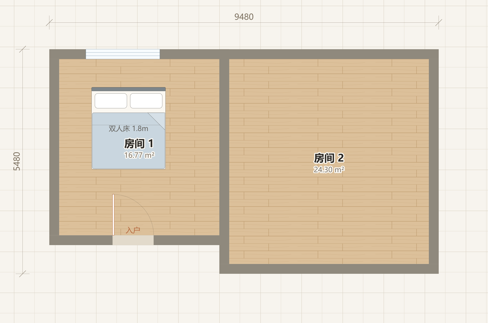

# 3D Home Design Preview

[中文](README.md) | English

Build your own floor plan in the browser, arrange furniture, then switch to 3D to preview your design or explore it in first person. Save and load the layout and interior design together without changing the source code to use a different floor plan.

The project uses vanilla HTML, CSS, JavaScript, SVG and Three.js, with no backend or build step. The interface supports Simplified Chinese, Traditional Chinese and English.



## Quick Start

### Open Directly

Download the repository and open `index.html` in your browser. Keep `floorplan-core.js`, `floorplan-editor.js` and `floorplan-projects.js` in the same directory; copying only the HTML file is insufficient.

The Three.js modules required for 3D are loaded through the jsDelivr CDN. An internet connection and a modern browser with WebGL support are required.

### Run a Local Static Server

Clone the repository:

```bash
git clone https://github.com/zhujiuyi/3d-home-design-preview.git
cd 3d-home-design-preview
```

Windows:

```powershell
py -m http.server 8000 --bind 127.0.0.1
```

macOS / Linux:

```bash
python3 -m http.server 8000 --bind 127.0.0.1
```

Open [http://127.0.0.1:8000](http://127.0.0.1:8000). Press `Ctrl+C` in the server terminal to stop it.

Node.js is not required to use the application; it is only needed to run development tests.

## Workflow

### 1. Create and Build a Floor Plan

Choose **File → New floor plan**, enter a project name and start building. You can also choose **File → Load sample project** to explore the included design.

| Tool | Operation and Result |
| --- | --- |
| Room | Drag across the empty canvas to draw a rectangular room with linked walls on all four sides |
| Wall | Drag to draw a horizontal or vertical wall; choose its thickness and type: exterior, partition, bearing or low wall |
| Door / Sliding door / Window | Drag along a wall to create an opening, or click the wall to use the default width |
| Select / Move | Drag an existing element to move it, drag its blue handles to resize it, or enter exact dimensions in the properties panel |

Dimensions use **mm**. Room width and depth are measured inside the walls. On narrow screens, use **Build tools** to open the tool palette.

Wall snapping uses the actual solid edges, supporting corners, T-junctions, straight extensions, moves and endpoint adjustments. Walls of different thicknesses align to the nearest face, with blue markers showing a snap. Choose a 50 / 100 / 200 mm grid, or hold `Shift` to temporarily disable grid and wall-edge snapping.

Walls and openings linked to a newly drawn room update when the room moves or resizes. Moving a room also carries the furniture inside it. Dragging a linked perimeter wall moves it inward or outward and adjusts the corresponding room boundary. Independently drawn walls can move freely, taking their linked openings with them.

Select a hinged door to change its name, width, swing direction, hinge end or entry-door designation. All floor plan edits support undo and redo. Press `Esc` during drawing or dragging to cancel the operation.

### 2. Arrange Furniture and Choose Materials

Choose **Finish building · Furnish**, then click a preset in the furniture library to add it or drag it onto a specific spot in the plan.

- The library contains **60 furniture and appliance presets** in six categories: bedroom, living room, dining & kitchen, bathroom, appliances, and study & leisure.
- Move, rotate, duplicate or delete furniture, and adjust its width, depth, color and stacking order. Enable **Wall snap** to align furniture with nearby walls while dragging.
- Select a room to change its name and flooring. There are 8 material presets, including oak, walnut, tiles, marble, anti-slip tiles, terrazzo and carpet.
- The measuring tool snaps to wall faces. Hold `Shift` to lock a measurement horizontally or vertically.
- Choose a 1:60 / 1:100 plan scale and toggle dimensions, room names, furniture, grid and bearing-wall layers.
- **Demolish** marks non-bearing walls for removal or restores them. Bearing and exterior walls are protected in this tool.

Room areas are shown in **m²**, with a total for net usable floor area. Flooring cost is estimated as room area × material unit price × **1.05**, including 5% waste. This estimate covers flooring materials only.

### 3. Preview in 3D

Click **3D Scene** or press `T`. The scene is generated from the current floor plan; walls, openings, room floors and furniture stay in sync with the 2D design.

- Use orbit, oblique and top-down views, or select a room in the room list to focus on it.
- Switch between full-height and cut-away walls, adjust the time of day, and enable night lighting.
- Select and drag furniture in 3D; its position updates in 2D as well.
- Walk with `WASD` / arrow keys and the mouse on desktop. On touch devices, use the virtual joystick and drag the scene to look around.
- Click hinged doors to open or close them. During walkthrough, press `E` to operate the door directly ahead.
- Choose **File → Export image** to save the current 2D or 3D view as PNG.

### 4. Save and Restore a Complete Project

Use the **File** menu to save, load or export projects. Autosave runs automatically after edits.

| Operation | Purpose |
| --- | --- |
| Autosave | Automatically stores the current complete project after edits and restores it when you reopen the same address in the same browser |
| Save project locally | Saves a named project in the current browser; saving the same name updates its existing record |
| Load saved project | Restores the complete floor plan and interior design from a named local save |
| Export full project JSON | Saves a complete project file for backup or transfer |
| Import full project JSON | Restores a project from a JSON file; data is validated before importing, and invalid files do not overwrite the current project |
| Export image | Saves a PNG image of the current view to share the design |

A complete project includes its name, room outlines, walls, openings and their links, room names and flooring, furniture positions / dimensions / rotations / colors, demolition records and measurement lines.

Autosave and named saves are separate records. Local saves are not shared between browsers or between different protocols, hostnames or ports. Use JSON export / import when moving to another device or address.

JSON files do not include the camera position, walkthrough state, lighting settings or undo history. Undo history holds up to 150 steps and resets on refresh. Only complete **v2 JSON** projects are supported; older files containing interior layouts alone are incompatible.

Import the included [custom floor plan example](examples/拖拽搭建示例.json) to explore a project with two rooms, openings and furniture.

## Keyboard Shortcuts

Canvas shortcuts are disabled while editing text or numbers in an input field.

| Key | Action |
| --- | --- |
| `T` | Switch between 2D and 3D |
| `V` | Select / Move; keeps floor plan elements editable in building mode |
| `M` / `X` | Measure / Demolish walls |
| `Delete` / `Backspace` | Delete the selected furniture item or floor plan element |
| Arrow keys / `Shift` + arrow keys | Nudge the selected element by 10 mm / 100 mm |
| `R` / `Shift+R` | Rotate furniture 90° clockwise / counterclockwise |
| `R` with a hinged door selected in building mode | Flip the door's swing direction |
| `Ctrl/⌘ + D` | Duplicate selected furniture |
| `Ctrl/⌘ + Z` | Undo |
| `Ctrl/⌘ + Shift + Z` or `Ctrl/⌘ + Y` | Redo |
| `F` / `+` / `-` | Fit to window / Zoom in / Zoom out |
| `[` / `]` | Show or hide the left tool library / right properties panel |
| `Shift + F` | Fullscreen |
| `Esc` | Cancel drawing, dragging or the current operation; pause during walkthrough |
| Walkthrough: `WASD` / arrow keys, `Shift`, `E` | Move, walk faster, open or close the hinged door ahead |

## Current Limitations

- The room tool draws rectangles; the wall tool draws horizontal or vertical walls.
- Enclosing an area with independent walls does not automatically create a room, floor or area calculation. Use the **Room** tool to create the room.
- Room outlines and walls in the built-in sample are independent data and must be adjusted separately. Newly drawn rooms link their walls and openings automatically.
- Resizing a room updates its walls and openings while furniture dimensions remain unchanged.
- General wall height is 2.8 m, and cut-away height is 1.2 m. Sliding doors are currently static.

## Project Structure and Development

| Path | Contents |
| --- | --- |
| `index.html` | Interface, 2D / 3D rendering, furniture library and initial sample data |
| `floorplan-core.js` | Complete project validation, stable IDs, geometry bounds and wall cuts for openings |
| `floorplan-editor.js` | Drag-based floor plan editing, wall snapping, dimensions and properties |
| `floorplan-projects.js` | Project creation, named saves, loading and JSON file operations |
| `examples/` | Importable complete project and preview image |
| `tests/` | Data, saving and loading, history and editor interaction tests |

2D uses SVG, and 3D uses Three.js r160. The current layout is managed by `state.floorplan` and is saved and included in undo / redo alongside furniture and materials.

Users can change layouts through the interface. For development, edit the initial sample arrays `ROOMS`, `WALLS`, `WINS`, `DOORS` and `SLIDES` in `index.html`, or customize the material library `MATS`, furniture library `LIB` and model function `buildFurniture()`.

Tests use the built-in Node.js test runner, with no additional test dependencies:

```bash
node --test tests/*.test.cjs
```

Coverage includes complete project round trips, invalid-data protection, autosave and named saves, undo / redo, drag creation and resizing, linked openings, and snapping at corners and T-junctions, with different wall thicknesses and reversed drag directions.

## Attribution and License

This project extends [wy51ai/floorplan-3d](https://github.com/wy51ai/floorplan-3d) with editable layouts, complete project saving and loading, and improved wall interaction and snapping. The original author is **wuyi**, whose original social account is [@akokoi1](https://x.com/akokoi1).

Released under the [MIT License](LICENSE), retaining the original copyright notice.
